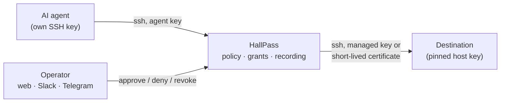

<p align="center">
  
</p>

<h1 align="center">HallPass</h1>

<p align="center">
  <strong>A terminating SSH gateway for AI agents.</strong><br>
  Agents get time-bound, approved access to your servers, never the credentials, and every session is recorded.
</p>

<p align="center">
  <a href="https://aurimasniekis.github.io/go-hallpass/">Documentation</a> ·
  <a href="https://aurimasniekis.github.io/go-hallpass/guide/install-docker">Install</a> ·
  <a href="https://aurimasniekis.github.io/go-hallpass/agents/">Agent guide</a> ·
  <a href="docs/security-guarantees.md">Security guarantees</a>
</p>

> [!WARNING]
> **Pre-release, not production-ready.** No version has been tagged and the release gates are not met: no 24-hour
> soak, no external review of the recording format, and CI not yet green on GitHub. The current
> evaluation is in [docs/evidence/unreleased/release-gates.md](docs/evidence/unreleased/release-gates.md), and
> per-requirement status (implemented versus tested) in [docs/PLAN.md](docs/PLAN.md) §21.

<picture>
  <source media="(prefers-color-scheme: dark)" srcset="site/public/screenshots/dashboard-dark.png">
  
</picture>

## Why

The quickest way to let an AI agent work on a server is to put its key in `authorized_keys`. That key works forever,
on every server it was copied to, for any task, without anyone's approval, and leaves little trace of what it did.
Anything the agent can read can also end up in a prompt or a log.

HallPass sits in between. The agent keeps **only its own key** and talks to HallPass with plain `ssh`. Policy and a
human decide what it may use and for how long. HallPass logs in to the destination with a credential the agent never
sees, records the session, and cuts it off when the grant ends.

## How it works



1. You register the agent's public key and enroll servers, each with roles (a remote account plus what it allows).
2. The agent runs `ssh center list`, `ssh center exec web1 -- uptime`, `ssh -t center connect web1`.
3. Policy decides per agent, server and role: hidden, requestable (a human approves), or approved automatically up to
   a limit.
4. HallPass opens the destination session itself, records it, and ends it when the grant ends.

**Key features**

- **No credentials for agents.** HallPass keeps destination login keys encrypted, or signs OpenSSH certificates that
  live about two minutes. Destination host keys are pinned; there is no trust on first use.
- **Default-deny policy** by agent, server and role groups or labels, with an effective-access preview.
- **Human approval** in the web console, Slack or Telegram. A chat button is never authorization by itself: the
  approver is re-checked when they click.
- **Time-bound grants** that never extend. Expiry, revocation, a disabled agent or lockdown end live sessions within
  5 seconds.
- **Recording on by default, fail closed.** Encrypted per segment, integrity-chained, replayable in the browser next
  to a session timeline, plus a hash-chained audit log.
- **Hidden inventory.** Agents see aliases only. An unknown server and a forbidden one give the same answer.
- **Operators** with Argon2id passwords and TOTP or OIDC single sign-on, and administrator, approver, auditor and
  viewer roles.
- **One Go binary** with the web UI embedded and SQLite storage. Backup and restore, integrity anchors, Prometheus
  metrics, health checks and optional OpenTelemetry tracing.

HallPass is **not a sandbox**: an approved shell can do what its remote account can do. Pair it with
[destination hardening](docs/destination/hardening.md), and run it like a bastion host, because it sees every session
in plaintext.

## Screenshots

| | |
|---|---|
| <br>**A request waiting for approval** | <br>**Approving with a chosen duration** |
| <br>**Replay of a recorded shell** | <br>**Session timeline** |
| <br>**Guided server onboarding** | <br>**Default-deny policy** |

**What the agent sees:**


All screenshots come from a throwaway instance with fictional data.

## Quick start

No release has been published yet, so both paths build from source. Full guides:
[Docker Compose](https://aurimasniekis.github.io/go-hallpass/guide/install-docker),
[binary with systemd](https://aurimasniekis.github.io/go-hallpass/guide/install-binary), or a
[local trial in development mode](https://aurimasniekis.github.io/go-hallpass/guide/try-locally).

### Docker Compose

```sh
make image IMAGE=hallpass:local VERSION=v0.0.0-local
cd deploy
install -d -m 0700 secrets && sudo chown 65532:65532 secrets
docker run --rm --user 65532:65532 -v "$PWD/secrets:/out" hallpass:local keys init-kek --out /out/hallpass.kek
cp examples/hallpass.container.yaml hallpass.yaml && $EDITOR hallpass.yaml   # public_url, egress.allow_cidrs
export HP_IMAGE=hallpass HP_VERSION=local HP_CONFIG_FILE=./hallpass.yaml
docker compose run --rm hallpass migrate
docker compose run --rm hallpass hostkey show --host center      # known_hosts line for agents
docker compose run --rm hallpass admin bootstrap                  # one-time setup link
docker compose up -d
```

Back up `secrets/hallpass.kek` offline right away: without it, nothing can be decrypted. Put a TLS reverse proxy in
front of `127.0.0.1:8080`, open the setup link, and follow
[First run](https://aurimasniekis.github.io/go-hallpass/guide/first-run).

### Binary

Requirements: Go 1.27 or later, Node 24 and pnpm.

```sh
(cd web && pnpm install --frozen-lockfile && pnpm build)          # web UI
go build -tags embedui -o bin/hallpass ./cmd/hallpass              # binary with the UI embedded
bin/hallpass keys init-kek --out /etc/hallpass/kek                 # master key: back it up offline
cp deploy/examples/hallpass.example.yaml /etc/hallpass/hallpass.yaml   # set public_url, egress.allow_cidrs
bin/hallpass migrate --config /etc/hallpass/hallpass.yaml
bin/hallpass admin bootstrap --config /etc/hallpass/hallpass.yaml  # one-time setup link
bin/hallpass serve --config /etc/hallpass/hallpass.yaml
```

Run it as a dedicated service user with the [systemd unit](deploy/systemd/hallpass.service); the guide covers the
user, file permissions and hardening. The web console listens on port 8080 and must sit behind TLS. Agents connect on
port 2222.

## For agents

Point an SSH host alias at the gateway, pin its host key, and use plain `ssh`:

```sh
ssh center list                                               # servers and roles you may use
ssh center exec web1 --role inspect -- df -h /var             # auto-approved roles run at once
ssh center 'exec web1 --role deploy --reason "Deploy 1.4.3" -- ls /srv/app'   # waits for approval
ssh -t center connect web1 --role inspect                     # interactive shell
ssh center status req_01… --wait                              # keep waiting on a pending request
```

Wrap the whole gateway command in single quotes when a value has spaces: ssh joins its arguments, so inner quotes
must survive your local shell. Gateway errors use exit codes 80–90. See the
[agent guide](docs/agent/guide.md).

**Agent skill.** [`integrations/skills/hallpass/`](integrations/skills/hallpass/) teaches Claude Code, Codex and
similar agents to use the gateway properly: honest reasons, no request spamming, focused commands, no workarounds.

```
/plugin install hallpass --marketplace aurimasniekis/go-hallpass          # Claude Code
mkdir -p ~/.codex/skills && cp -R integrations/skills/hallpass ~/.codex/skills/   # Codex
```

The repository is currently private, so installing from GitHub needs access to it. Other options are in
[integrations/README.md](integrations/README.md).

## Documentation

The documentation website is **<https://aurimasniekis.github.io/go-hallpass/>** (built from [`site/`](site/)).

| Topic | Where |
|---|---|
| Getting started, operator and agent guides | [Website](https://aurimasniekis.github.io/go-hallpass/) |
| Operator reference (install, configuration, keys, backup, SSO, approvals, incidents) | [docs/operator/](docs/operator/) |
| Agent guide, exit codes, JSON schemas | [docs/agent/](docs/agent/) |
| Destination hardening, destination-side audit | [docs/destination/](docs/destination/) |
| Security guarantees and threat model | [docs/security-guarantees.md](docs/security-guarantees.md), [docs/THREAT_MODEL.md](docs/THREAT_MODEL.md) |
| REST API (OpenAPI 3.1) | [api/openapi.yaml](api/openapi.yaml) |
| Recording format | [docs/formats/hprec1.md](docs/formats/hprec1.md) |
| Product contract, plan, decisions | [docs/GOAL.md](docs/GOAL.md), [docs/PLAN.md](docs/PLAN.md), [docs/DECISIONS.md](docs/DECISIONS.md) |
| Versioning, changelog | [docs/VERSIONING.md](docs/VERSIONING.md), [CHANGELOG.md](CHANGELOG.md) |

To work on the website: `cd site && pnpm install && pnpm dev`.

## Security

Read [docs/security-guarantees.md](docs/security-guarantees.md) before deploying. It lists what HallPass guarantees,
what it explicitly does not, and which guarantees are only implemented versus tested. None is externally verified
yet. Report vulnerabilities privately; see [SECURITY.md](SECURITY.md).

## Contributing

See [CONTRIBUTING.md](CONTRIBUTING.md) for development setup, the checks run before every commit
(`make lint custom-vet race coverage sqlc-check api-check`, the web checks, and the OpenSSH, fault-injection and fuzz
suites), and commit rules.

## License

[Apache License 2.0](LICENSE). See also [NOTICE](NOTICE).
