<p align="center">
  
</p>

<h1 align="center">HallPass</h1>

<p align="center">
  <strong>A terminating SSH gateway for AI agents.</strong><br>
  Agents get time-bound, approved access to your servers, never the credentials, and every session is recorded.
</p>

<p align="center">
  <a href="https://aurimasniekis.github.io/go-hallpass/">Documentation</a> ·
  <a href="https://aurimasniekis.github.io/go-hallpass/guide/install-docker">Install</a> ·
  <a href="https://aurimasniekis.github.io/go-hallpass/agents/">Agent guide</a> ·
  <a href="https://aurimasniekis.github.io/go-hallpass/security/">Security model</a>
</p>

<picture>
  <source media="(prefers-color-scheme: dark)" srcset="site/public/screenshots/dashboard-dark.png">
  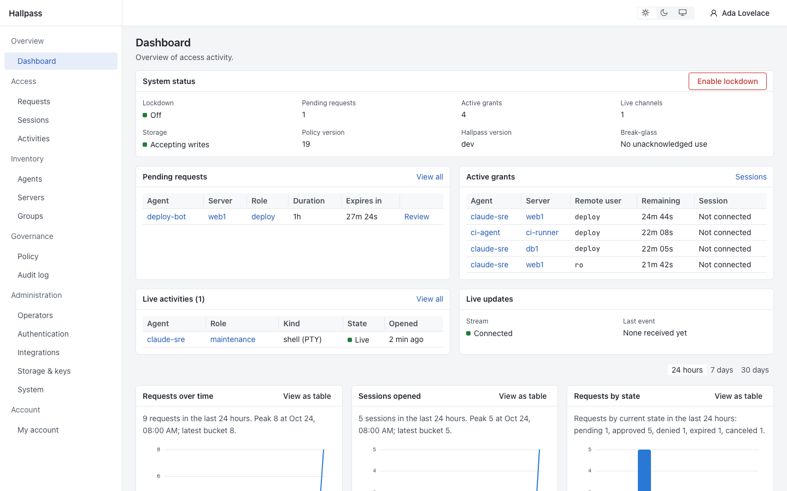
</picture>

## Why

The quickest way to let an AI agent work on a server is to put its key in `authorized_keys`. That key works forever,
on every server it was copied to, for any task, without anyone's approval, and leaves little trace of what it did.
Anything the agent can read can also end up in a prompt or a log.

HallPass sits in between. The agent keeps **only its own key** and talks to HallPass with plain `ssh`. Policy and a
human decide what it may use and for how long. HallPass logs in to the destination with a credential the agent never
sees, records the session, and cuts it off when the grant ends.

## How it works

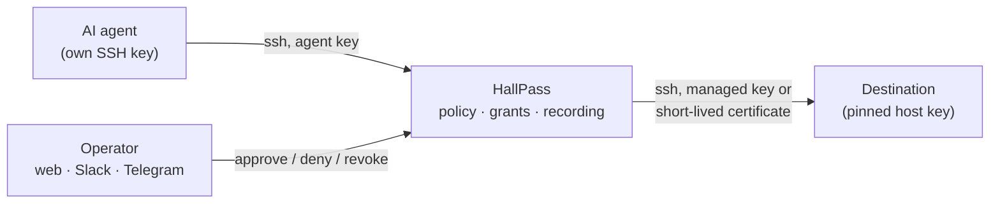

1. You register the agent's public key and enroll servers, each with roles (a remote account plus what it allows).
2. The agent runs `ssh center list`, `ssh center exec web1 -- uptime`, `ssh -t center connect web1`, plain
   `git clone center:github/acme/api.git`, or `scp build.tar web1@center:/tmp/`.
3. Policy decides per agent, server and role: hidden, requestable (a human approves), or approved automatically up to
   a limit.
4. HallPass opens the destination session itself, records it, and ends it when the grant ends.

**Key features**

- **No credentials for agents.** HallPass keeps destination login keys encrypted, or signs OpenSSH certificates that
  live about two minutes. Destination host keys are pinned; there is no trust on first use.
- **Default-deny policy** by agent, server and role groups or labels, with an effective-access preview.
- **Human approval** in the web console, Slack or Telegram, optionally by several distinct approvers for sensitive
  roles. A chat button is never authorization by itself: the approver is re-checked when they click.
- **Time-bound grants** that never extend. Expiry, revocation, a disabled agent or lockdown end live sessions within
  5 seconds.
- **Recording on by default, fail closed.** Encrypted per segment, integrity-chained, replayable in the browser next
  to a session timeline, plus a hash-chained audit log.
- **Git remotes.** Agents clone and push with plain git through the gateway (GitHub, GitLab, Bitbucket or your own
  host). Access profiles limit repositories with patterns and pushes with branch, protected-branch and tag rules;
  force-pushes are refused unless allowed. Refused pushes never reach the host.
- **File transfer.** Roles with the file-transfer capability accept `scp` and `sftp`. Every upload, download,
  rename and deletion is recorded with its path, size and SHA-256.
- **Hidden inventory.** Agents see aliases only. An unknown server and a forbidden one give the same answer.
- **Operators** with Argon2id passwords and TOTP or OIDC single sign-on, and administrator, approver, auditor and
  viewer roles.
- **Configuration as code** with the [Terraform provider](https://github.com/aurimasniekis/terraform-provider-hallpass)
  and API tokens: agents, servers, git remotes, roles, keys, policy, single sign-on and chat approvals.
- **One Go binary** with the web UI embedded and SQLite storage. Encrypted, scheduled backups to S3-compatible storage
  (or to disk), restore, integrity anchors, Prometheus metrics, health checks and optional OpenTelemetry tracing.

HallPass is **not a sandbox**: an approved shell can do what its remote account can do. Pair it with
[destination hardening](https://aurimasniekis.github.io/go-hallpass/destinations/hardening), and run it like a bastion host, because it sees every session
in plaintext.

## Screenshots

| | |
|---|---|
| 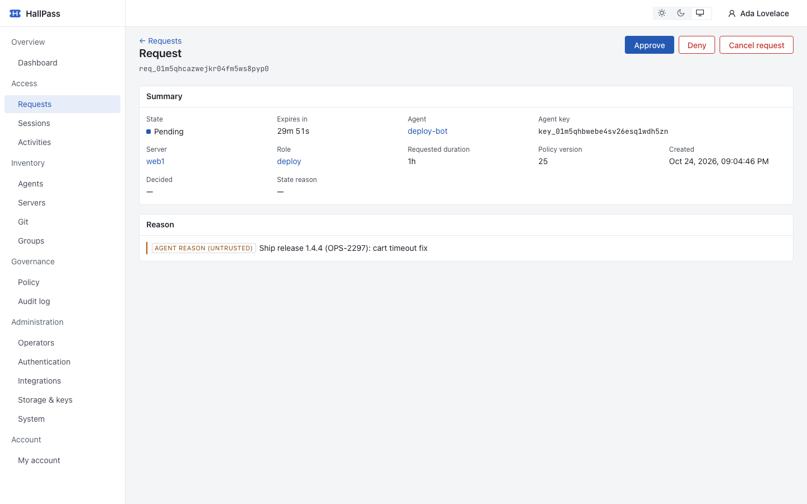<br>**A request waiting for approval** | 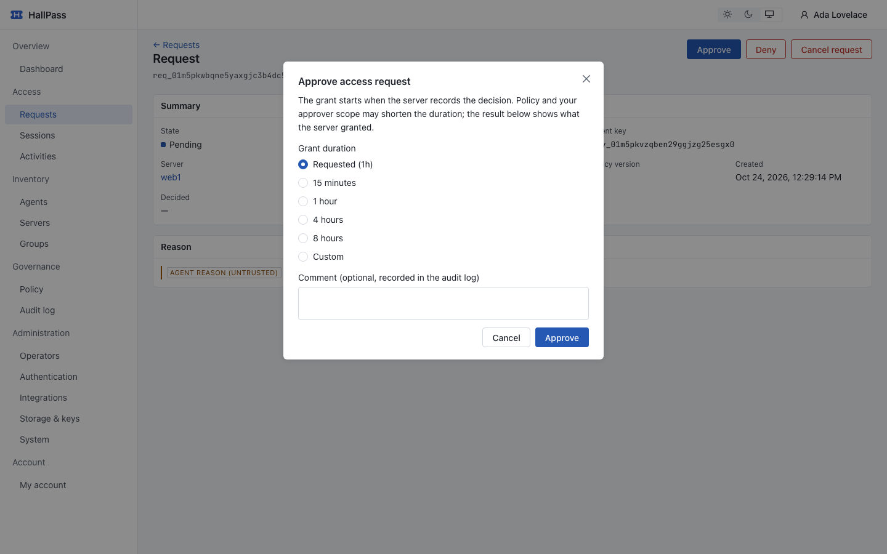<br>**Approving with a chosen duration** |
| 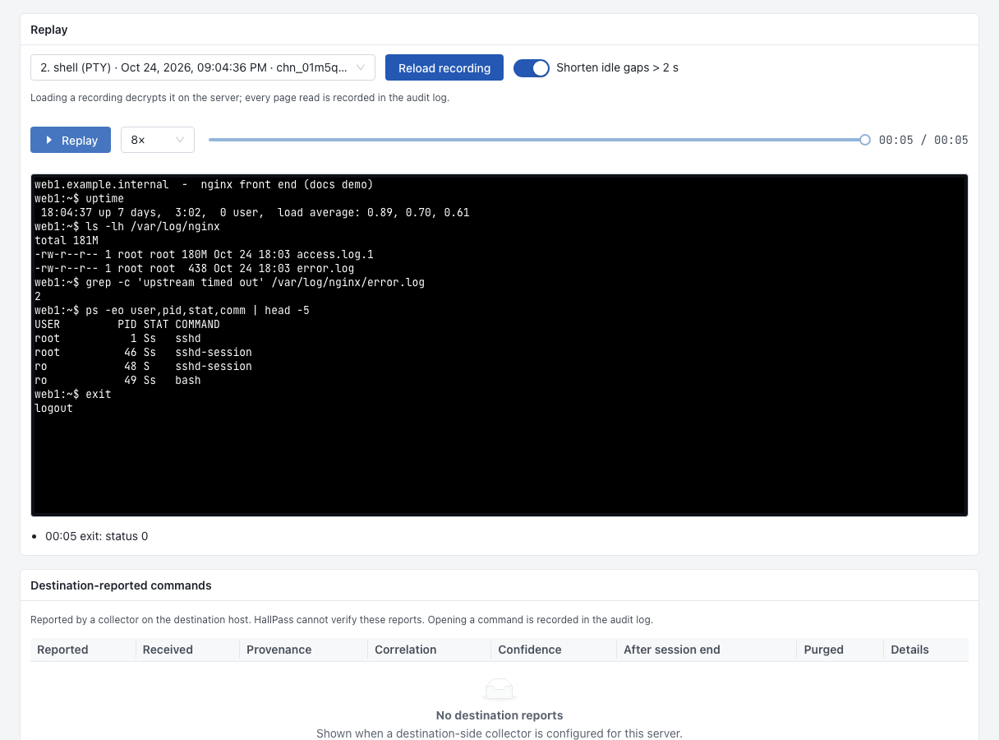<br>**Replay of a recorded shell** | 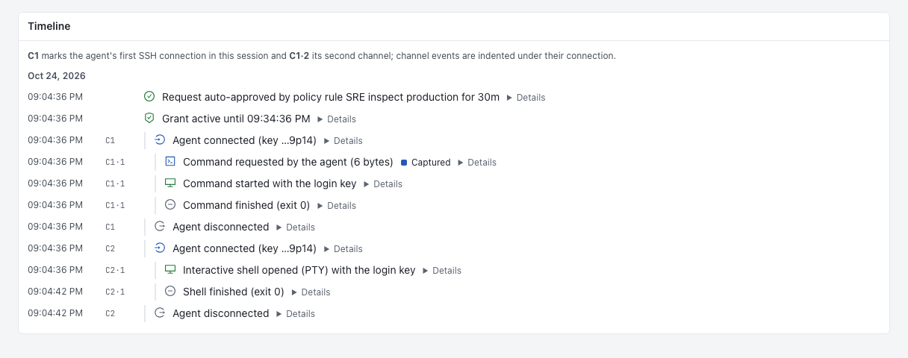<br>**Session timeline** |
| 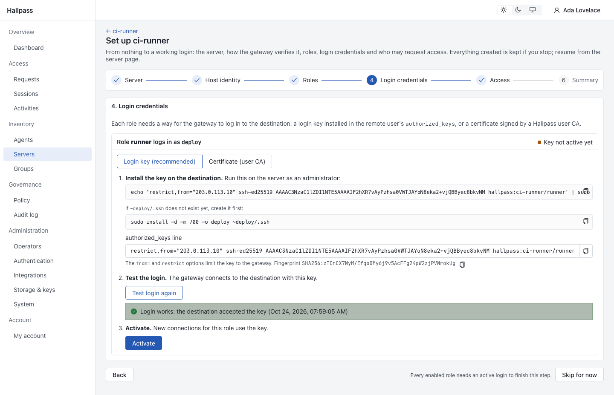<br>**Guided server onboarding** | 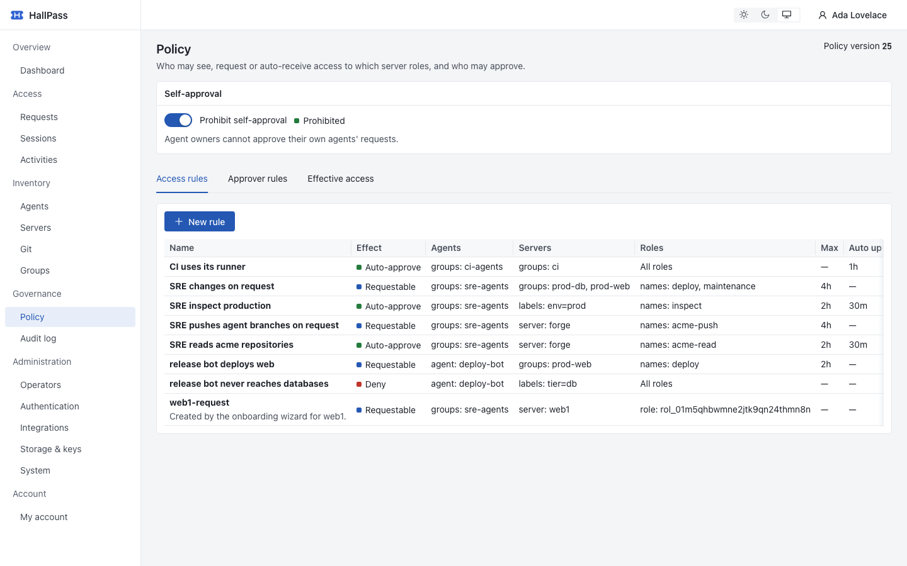<br>**Default-deny policy** |
| 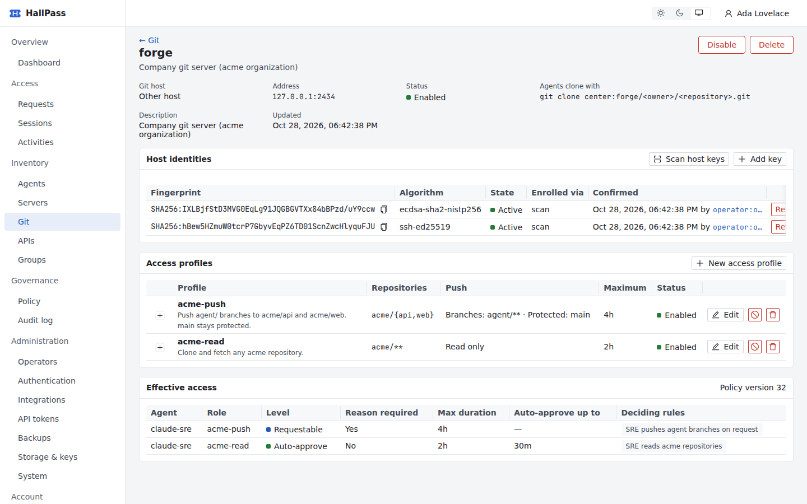<br>**Git remote with access profiles** | 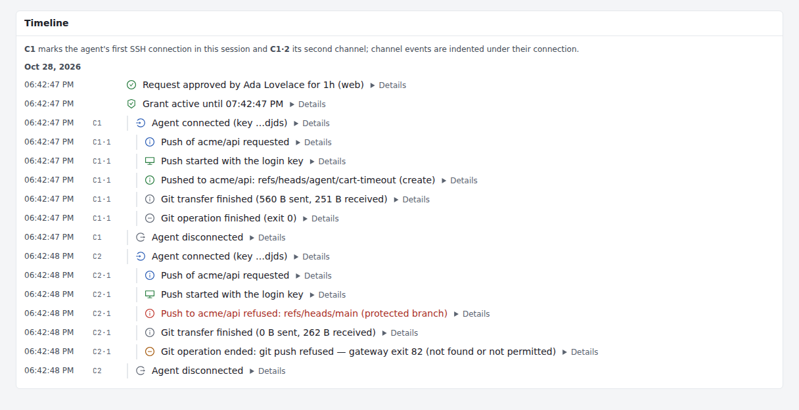<br>**Pushes in the timeline** |

**What the agent sees:**

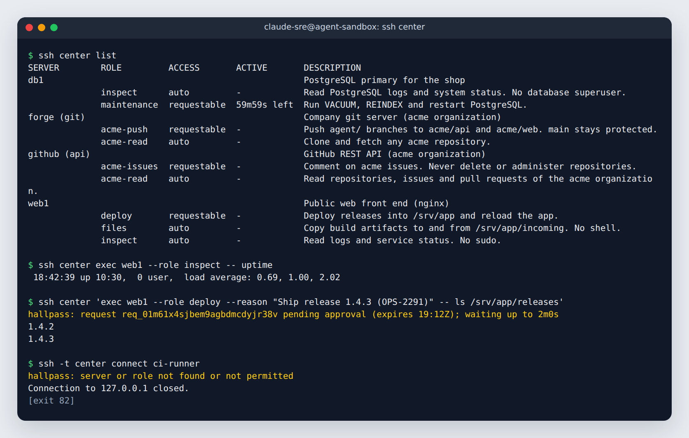

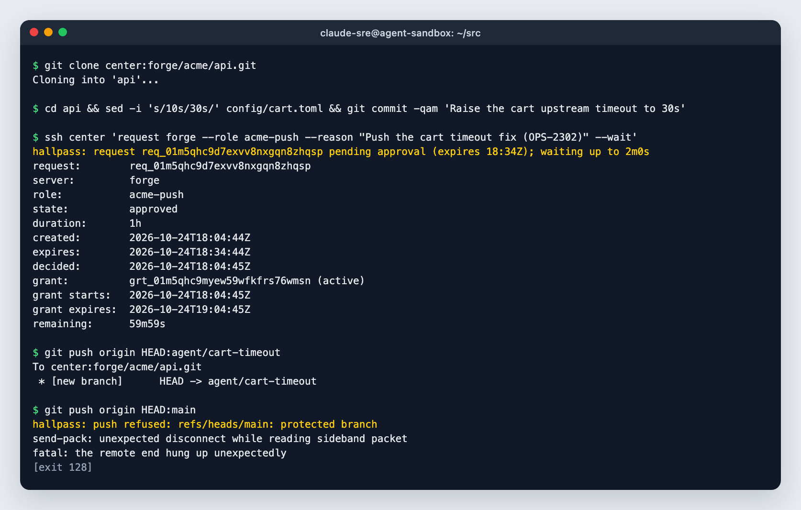

## Quick start

Full guides: [Docker Compose](https://aurimasniekis.github.io/go-hallpass/guide/install-docker),
[binary with systemd](https://aurimasniekis.github.io/go-hallpass/guide/install-binary), or a
[local trial in development mode](https://aurimasniekis.github.io/go-hallpass/guide/try-locally).

### Docker Compose

Images are on Docker Hub as [`aurimasniekis/hallpass`](https://hub.docker.com/r/aurimasniekis/hallpass) (mirrored to
`ghcr.io/aurimasniekis/go-hallpass`) for linux/amd64 and linux/arm64.

```sh
export HP_VERSION=0.4.0
gh attestation verify oci://docker.io/aurimasniekis/hallpass:$HP_VERSION --repo aurimasniekis/go-hallpass
git clone --depth 1 --branch v$HP_VERSION https://github.com/aurimasniekis/go-hallpass.git && cd go-hallpass/deploy
install -d -m 0700 secrets && sudo chown 65532:65532 secrets
docker run --rm --user 65532:65532 -v "$PWD/secrets:/out" aurimasniekis/hallpass:$HP_VERSION keys init-kek --out /out/hallpass.kek
cp examples/hallpass.container.yaml hallpass.yaml && $EDITOR hallpass.yaml   # public_url, egress.allow_cidrs
export HP_CONFIG_FILE=./hallpass.yaml
docker compose run --rm hallpass migrate
docker compose run --rm hallpass hostkey show --host center      # known_hosts line for agents
docker compose run --rm hallpass admin bootstrap                  # one-time setup link
docker compose up -d
```

Back up `secrets/hallpass.kek` offline right away: without it, nothing can be decrypted. Put a TLS reverse proxy in
front of `127.0.0.1:8080`, open the setup link, and follow
[First run](https://aurimasniekis.github.io/go-hallpass/guide/first-run).

### Binary

Release archives for linux/amd64, linux/arm64 and darwin/arm64 are on the
[releases page](https://github.com/aurimasniekis/go-hallpass/releases), with `SHA256SUMS`, SBOMs and build provenance.

```sh
V=0.4.0; base=https://github.com/aurimasniekis/go-hallpass/releases/download/v$V
curl -fLO "$base/hallpass_${V}_linux_amd64.tar.gz" -fLO "$base/SHA256SUMS"
sha256sum --check --ignore-missing SHA256SUMS
gh attestation verify "hallpass_${V}_linux_amd64.tar.gz" --repo aurimasniekis/go-hallpass
tar -xzf "hallpass_${V}_linux_amd64.tar.gz" && cd "hallpass_${V}_linux_amd64"
sudo install -m 0755 hallpass /usr/local/bin/hallpass
hallpass keys init-kek --out /etc/hallpass/kek                     # master key: back it up offline
cp hallpass.example.yaml /etc/hallpass/hallpass.yaml               # set public_url, egress.allow_cidrs
hallpass migrate --config /etc/hallpass/hallpass.yaml
hallpass admin bootstrap --config /etc/hallpass/hallpass.yaml      # one-time setup link
hallpass serve --config /etc/hallpass/hallpass.yaml
```

To build from source instead (Go 1.27+, Node 24, pnpm): `(cd web && pnpm install --frozen-lockfile && pnpm build)`,
then `go build -tags embedui -o bin/hallpass ./cmd/hallpass`.

Run it as a dedicated service user with the [systemd unit](deploy/systemd/hallpass.service); the guide covers the
user, file permissions and hardening. The web console listens on port 8080 and must sit behind TLS. Agents connect on
port 2222.

## For agents

Point an SSH host alias at the gateway, pin its host key, and use plain `ssh`:

```sh
ssh center list                                               # servers and roles you may use
ssh center exec web1 --role inspect -- df -h /var             # auto-approved roles run at once
ssh center 'exec web1 --role deploy --reason "Deploy 1.4.3" -- ls /srv/app'   # waits for approval
ssh -t center connect web1 --role inspect                     # interactive shell
ssh center status req_01… --wait                              # keep waiting on a pending request
git clone center:github/acme/api.git                          # git remotes: plain git, same approvals
scp build.tar web1@center:/tmp/                               # file transfer: the SSH user names the server
sftp web1+deploy@center                                       # ... and "+role" picks the role
```

Wrap the whole gateway command in single quotes when a value has spaces: ssh joins its arguments, so inner quotes
must survive your local shell. Gateway errors use exit codes 80–90. See the
[agent guide](https://aurimasniekis.github.io/go-hallpass/agents/).

**Agent skill.** The [`hallpass` skill](https://aurimasniekis.github.io/go-hallpass/agents/skill) teaches Claude Code, Codex and
similar agents to use the gateway properly: honest reasons, no request spamming, focused commands, no workarounds.

```
/plugin install hallpass --marketplace aurimasniekis/go-hallpass          # Claude Code
mkdir -p ~/.codex/skills && cp -R integrations/skills/hallpass ~/.codex/skills/   # Codex
```

Other ways to install it are in the [agent skill guide](https://aurimasniekis.github.io/go-hallpass/agents/skill).

## Documentation

Everything is on the **[documentation website](https://aurimasniekis.github.io/go-hallpass/)**:

- [Getting started](https://aurimasniekis.github.io/go-hallpass/guide/what-is-hallpass): concepts, installing with Docker or systemd, first run, first agent.
- [Operator guide](https://aurimasniekis.github.io/go-hallpass/operators/): servers, policy, approvals, Slack and Telegram, single sign-on, sessions, backup,
  monitoring and incident runbooks.
- [Agent guide](https://aurimasniekis.github.io/go-hallpass/agents/): commands, exit codes and the agent skill.
- [Reference](https://aurimasniekis.github.io/go-hallpass/reference/configuration): configuration, command line and REST API.
- [Security model](https://aurimasniekis.github.io/go-hallpass/security/): what HallPass guarantees and what it does not.

## Security

Read the [security model](https://aurimasniekis.github.io/go-hallpass/security/) before deploying: it lists what HallPass guarantees and what it explicitly does
not. Report vulnerabilities privately; see [SECURITY.md](SECURITY.md).

## Contributing

See [CONTRIBUTING.md](CONTRIBUTING.md).

## License

[Apache License 2.0](LICENSE). See also [NOTICE](NOTICE).
